# AnDPoP 2.0 UI/UX prototype

**Status: prototype for review. No app code has changed.** This folder has the proposed redesign: the interactive prototype, screenshots and this spec. Once the design is approved, it will be ported to the existing Kotlin/Jetpack Compose app. Bluetooth, account and preference behaviour stay native.

| File | What it is |
| --- | --- |
| [`AnDPoP-v2-Prototype.html`](AnDPoP-v2-Prototype.html) | A single offline file with images and code embedded. Download it and open it in Chrome, Edge or Firefox. You click through it like the app. A side panel switches the theme, palette, device state, screen width (360, 384 or 412 dp), font scale (100 to 200%) and profile. The notes panel explains every screen. |
| [`screens/`](screens) | 26 PNG exports taken from the prototype |
| This README | Design decisions, tokens, screen inventory, Play Store checklist and port plan |

The prototype uses sample data. It does not talk to Bluetooth, Supabase or Android settings, so any real system action shows a short message instead.

Screens are listed in the left column. Use the gesture bar or <kbd>Esc</kbd> to go back. On a narrow window, open the notes with the “Design notes” button.

## Starting point

These sources describe the current app:
- the v1.5 dashboard (`AndpopDashboard.kt`, `AndpopBattery.kt`, `AndpopListeningModes.kt`, `AndpopDeviceSettings.kt`);
- the older LibrePods screens behind “More device controls” and Settings;
- onboarding, the account flow, overlays, widgets and notifications;
- the [v1.5 handoff](../v1.5-ui/IMPLEMENTATION.md).

The redesign keeps these from v1.5:
- the single-column dashboard and its section order;
- the real product photos;
- the Glacier, Iris and Guava palettes, with Glacier as the dark default and Iris as the light default;
- the per-component charging bolt;
- one green check on the selected listening mode;
- every setting and destination.

The problems it fixes:

1. **Two visual languages.** The Andpop screens use glass `devicePanel` cards. Every LibrePods screen uses `StyledList` segmented groups, and buttons are a mix of raw M3 and Styled* components. A third, iOS-style “Apple” branch in every component never runs, because `m3eEnabled` is always true.
2. **Heavy hierarchy.** Bold headline-size section titles compete with the content. Every panel has a gradient and a border.
3. **Duplicated screens.** “More device controls” repeats the dashboard: battery, name, listening mode, press and hold, microphone and accessibility.
4. **Two welcome screens.** On first run, the account screen (“Welcome to AnDPoP”) appears before onboarding (also “Welcome to AnDPoP”). It also takes over the whole app instead of being a navigation destination.
5. **Developer tools visible to users.** These include the Supabase URL and key form, “Bypass compatibility check”, the hidden 5-tap demo mode, and the Xposed and root wording in Troubleshooting.
6. **Play readiness gaps.** See the [checklist](#google-play-readiness).

## Screens

| | | | |
| --- | --- | --- | --- |
| 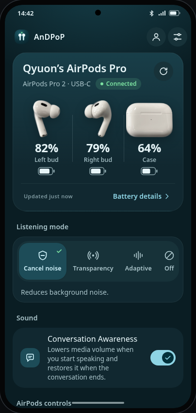 Dashboard |  Right bud and case charging | 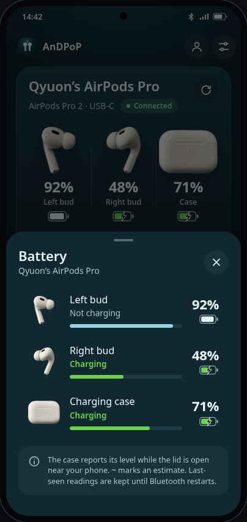 Battery details sheet |  Light · Iris |
|  AirPods Max |  Disconnected | 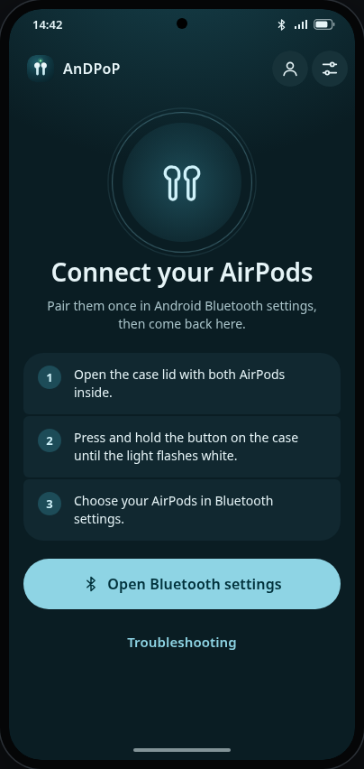 No AirPods yet |  Guava light · 360 dp |
| 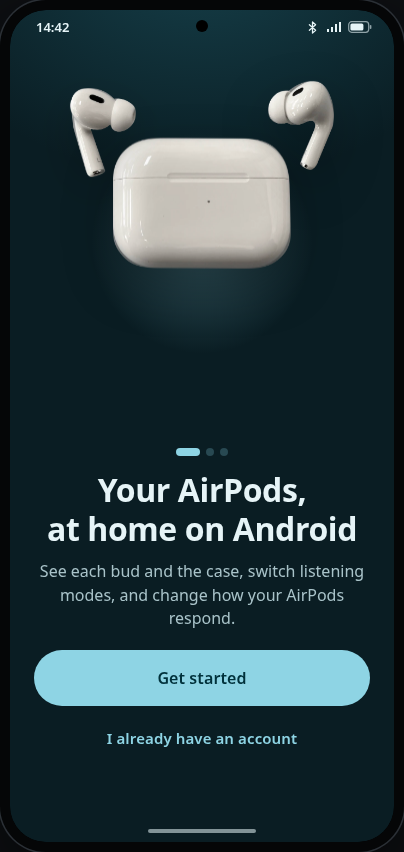 Welcome |  Privacy summary | 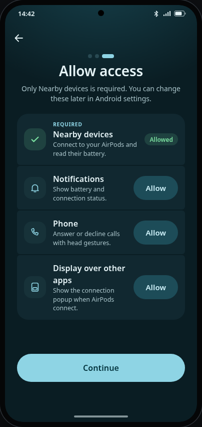 Permissions |  Press and hold |
| 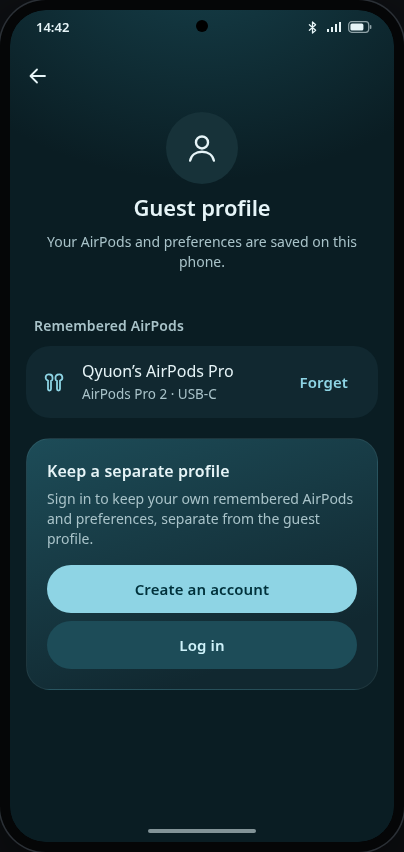 Account · guest | 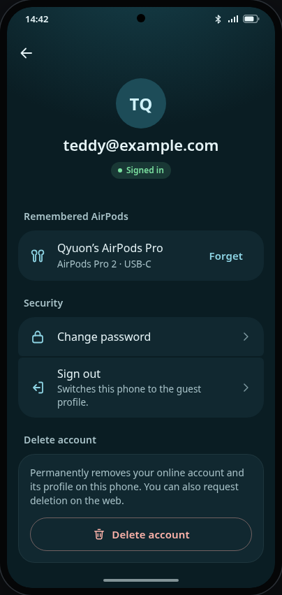 Account · signed in | 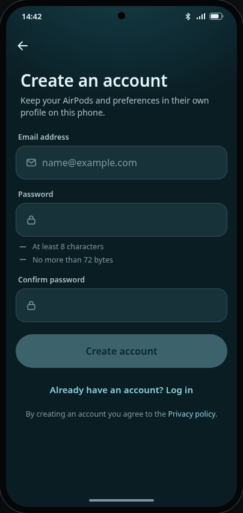 Create account |  Widgets |
|  Notification and QS tile | 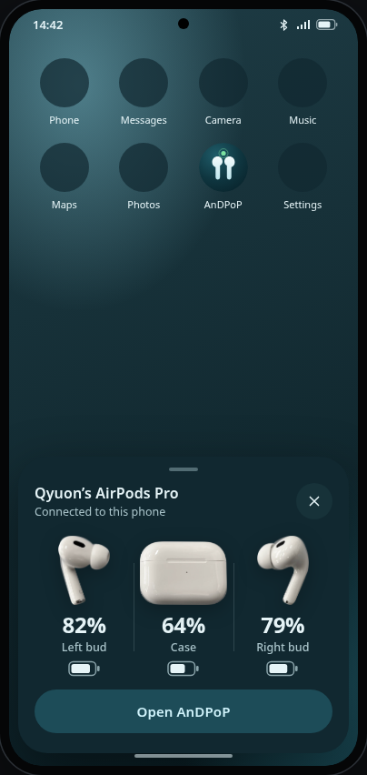 Connection popup | 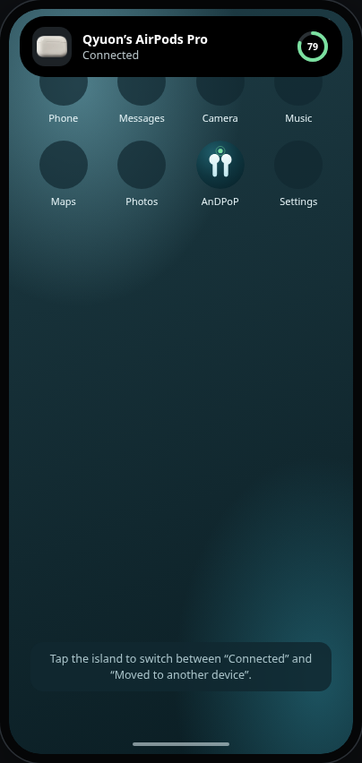 Dynamic Island popup |  Troubleshooting |

Full-length pages: [dashboard](screens/02-dashboard-full.png), [all device settings](screens/13-all-device-settings.png), [settings](screens/14-settings.png), [200% font scale](screens/23-large-text-200.png).
Boards: [design system](screens/25-design-system.png), [Play Store assets](screens/26-play-store-assets.png).

The prototype also covers name, microphone, accessibility, firmware, equalizer, adaptive audio, head gestures, hearing aid and its adjustments, transparency mode, hearing protection, call controls, credits, open-source licenses, developer options, log in with error state, password reset, the splash screen, the loading skeleton and the remaining battery states (low, last seen, estimated, no reading).

## Decisions that need your approval

These go beyond restyling. Each can be reverted on its own.

| # | Change | Why | Keep the current behaviour instead? |
| --- | --- | --- | --- |
| 1 | One welcome screen. Account becomes a normal screen reached from the avatar, and guest is the default first-run path. | Removes the double welcome. Predictive back works. Play reviewers can reach the app without signing in. | The account screen stays the first screen and keeps replacing `NavigationRoot` |
| 2 | “More device controls” becomes **All device settings**, grouped as Audio, Hearing health, Calls, Connection and charging, and About. Controls already on the dashboard are not repeated. | Removes six duplicates. Every destination stays reachable. | Keep the full legacy list |
| 3 | The six automatic-connection switches become two filter-chip groups. | One compact card in place of six rows | Keep the switches with their descriptions |
| 4 | **Developer options** (tap App version 7 times) hold the account service form, compatibility bypass, demo mode and “Act as an Apple device”. | Keeps testing tools out of a Play build | Leave them where they are |
| 5 | New launcher icon: two generic earbud stems with a “pop” dot, plus a themed (monochrome) layer | The current five mint bars read as an equalizer. The new shapes avoid Apple’s outlines. | Keep the current icon |
| 6 | One notification: battery and mode, with actions. The foreground-service notification is silent and minimized. | Two notifications are noisy. One channel currently shows the code text `BluetoothConnectionManager.aacpSocket?` in system settings. | Keep both |
| 7 | Widgets move to Jetpack Glance with app colours and rings | Rounded, themed, resizable | Keep the RemoteViews layouts and only restyle them |
| 8 | Bundle Roboto Flex instead of downloading it through Google Play services | Same type on every phone, including phones without GMS | Keep the downloadable font |
| 9 | The equalizer curve is driven by Low, Mid and High sliders | Works with TalkBack and is easier to hit | Keep the draggable canvas only |

## Design system

Built on Material 3 Expressive, which the app already loads through `MaterialExpressiveTheme`. One component set replaces both the Andpop and the Styled* families, and the unused Apple (liquid glass) branch is deleted. See the [design system board](screens/25-design-system.png).

### Colour roles

The prototype’s CSS variables map to `ColorScheme` roles in `AndpopPalette.kt`.

| Role (CSS) | Compose | Glacier dark | Iris dark | Guava dark | Glacier light | Iris light | Guava light |
| --- | --- | --- | --- | --- | --- | --- | --- |
| `--bg` | background, surfaceContainerLowest | `#0A1D23` | `#141128` | `#22111A` | `#EDF6F8` | `#F5F2FF` | `#FFF3F1` |
| `--s1` | surface, surfaceContainerLow | `#112830` | `#1C1834` | `#2C1922` | `#FFFFFF` | `#FFFFFF` | `#FFFFFF` |
| `--s2` | surfaceContainer | `#173239` | `#24203E` | `#36212B` | `#E2EFF2` | `#ECE7FA` | `#FBE8E7` |
| `--s3` | surfaceContainerHigh | `#1E3C45` | `#2D2849` | `#422935` | `#D3E5EA` | `#E0D9F4` | `#F5DADB` |
| `--on` | onSurface, onBackground | `#E6F4F7` | `#EEEAFF` | `#FFEEF2` | `#10272D` | `#1D1832` | `#2E1519` |
| `--on2` | onSurfaceVariant | `#A9C3C9` | `#BDB6DA` | `#DDBAC5` | `#45626A` | `#585172` | `#6D4E55` |
| `--on3` | outline | `#7E99A0` | `#8E87AC` | `#AD8C97` | `#516D73` | `#67608A` | `#7A5D64` |
| `--pri` | primary | `#8ED4E4` | `#CBBEFF` | `#FFB3C6` | `#1D6374` | `#5A4A99` | `#8D3954` |
| `--onpri` | onPrimary | `#00313B` | `#2A1E5C` | `#581A2E` | `#FFFFFF` | `#FFFFFF` | `#FFFFFF` |
| `--pc` | primaryContainer, secondaryContainer | `#1D4C58` | `#3A3068` | `#6A2C41` | `#CBEAF2` | `#E5DDFF` | `#FFD9E2` |
| `--onpc` | onPrimaryContainer | `#CFF2FA` | `#E8DFFF` | `#FFD9E2` | `#03313C` | `#1B0F4A` | `#3B0717` |

Shared semantic colours, dark / light. Success (connected, selected check) is `#7BE0A0` / `#1B7A43`. Warning (low battery) is `#FFB68A` / `#A3470F`. Error is `#FFB4AB` / `#B3261E`. The charging fill is `#69D447` / `#3AAA35`, and the bolt is `#0E1A12` with a pale edge.

The page background adds a soft radial glow from the top (`--glow`). Panels use flat tonal surfaces with a 1 dp hairline at 7% instead of a gradient and border.

### Type, shape, spacing

| Style | Size / line height / weight | Used for |
| --- | --- | --- |
| Display | 32/40 · 650 | Onboarding titles only |
| Headline | 28/35 · 600 | Large page titles on detail screens |
| Title large | 22/28 · 620 | Device name, sheet and dialog titles |
| Title medium | 16/24 · 600 | Top bar, tile titles |
| Body large / medium | 16/23 · 400, 14/20 · 400 | Row titles / supporting text |
| Label large | 14/20 · 600 | Section headers, in sentence case and the on-surface-variant colour |
| Battery value | 24/28 · 700, tabular figures | Percentages |

- Page margin 16 dp, content max width 560 dp. Two panes from 840 dp: dashboard on the left, detail on the right.
- Radii: hero card 28 dp, list groups 24 dp outside and 6 dp between rows with a 2 dp gap (the Android 16 Settings style), tiles 20–22 dp, controls full pill.
- Minimum touch target 48 dp. Rows are at least 56 dp.
- Shadows only on the sheet, dialogs, popup and widgets.

### Components

| Component | Replaces | Notes |
| --- | --- | --- |
| `AndpopTopBar` | `StyledScaffold` top bar, dashboard header row | A large title in the content collapses into the bar on scroll. Edge-to-edge behind the status bar. |
| `HeroDeviceCard` | `DeviceHeader` and the `BatterySection` panel | Name, model, status pill, refresh, battery cells, “Updated…”, Battery details |
| `BatteryCell`, `BatteryGlyph` | Same names in `AndpopBattery.kt` | Glyph rule unchanged: `level != null && charging && !lastSeen`, per component |
| `ListeningModeControl` | `DashboardListeningModes` | Sliding indicator in one row; 2 × 2 grid at font scale ≥ 1.3 or when the labels don’t fit; single column at ≥ 1.8 |
| `ListGroup`, `ListRow` | `ControlsGroup`, `DeviceSettingRow`, `StyledList`, `StyledListItem`, `StyledToggle` | One row with slots: leading icon, title, supporting text, value, and a trailing switch, radio, checkbox or chevron. At font scale ≥ 1.6 the value moves under the title. |
| `AndpopSwitch` | M3 `Switch`, `StyledSwitch` | M3 switch with a check icon in the thumb |
| `SegmentedChoice`, `FilterChips` | Radio lists for speeds and durations, connection switches | |
| `AndpopSlider` | `StyledSlider`, raw `Slider` | Value label, end labels, optional icons |
| `AndpopTextField` | `OutlinedTextField`, `StyledInputField` | Leading icon, show/hide, live rules, error text |
| `InfoBanner` | Hard-coded Play banner, case hint text | Info, warning, error |
| Buttons | `StyledButton`, raw M3 buttons | Filled, tonal, outlined, text and danger, 48 dp; 56 dp for primary page actions |

### Motion and haptics

| Interaction | Motion | Haptic |
| --- | --- | --- |
| Select listening mode | Indicator springs (dampingRatio 0.7, medium stiffness); check pops in | `SEGMENT_FREQUENT_TICK` |
| Toggle | Thumb grows 16 → 24 dp with a check | `TOGGLE_ON` / `TOGGLE_OFF` |
| Navigate | Shared-axis X, 300 ms. Predictive back scales the page to 0.9. | none |
| Refresh battery | Icon spins, values shimmer, numbers count up | `CONFIRM` |
| Blocked action (unchecking one of the last two cycle modes) | Checkbox shakes and the helper text turns to the error colour | `REJECT` |
| Remove animations is on | 150 ms cross-fades only | unchanged |

## Screen inventory and where each lands in Compose

Paths are relative to `app/src/main/java/me/kavishdevar/librepods/`.

| Screen | File(s) | Main changes |
| --- | --- | --- |
| Splash | `MainActivity.kt`, `res/values/themes.xml` | `installSplashScreen()` held until the profile and theme load |
| Welcome, Privacy, Permissions, Not supported | `presentation/screens/onboarding/*` | Three steps. Per-permission Allow buttons replace “Grant all”. The privacy text mentions the optional account. Strings move to resources. |
| Dashboard | `AndpopDashboard.kt`, `AndpopBattery.kt`, `AndpopListeningModes.kt`, `AndpopDeviceSettings.kt` | Hero card, tonal groups, avatar, L/R tiles, disconnected / unpaired / loading states |
| Battery details | `AndpopBattery.kt` (`BatteryQuickView`) | Rows with photo, status text, level bar, glyph and an explanation of ~ and last seen |
| Name, Microphone, Press and hold, Accessibility, Firmware | `RenameScreen.kt`, `MicrophoneSettingsScreen.kt`, `PressAndHoldSettingsScreen.kt`, `AccessibilitySettingsScreen.kt`, `VersionInfoScreen.kt` | Explicit Save for the name. The “two modes minimum” rule is now visible. Segmented speeds. Copyable versions. |
| All device settings | `AirPodsSettingsScreen.kt` and `components/*Settings.kt` | Grouped and de-duplicated. Premium banner and unlock button removed. Disconnect asks for confirmation. |
| Equalizer, Adaptive audio, Head gestures, Hearing aid, Adjustments, Transparency, Hearing protection, Call controls | matching `*Screen.kt` files | Shared slider and list templates. Head-gesture test shows a clear result; the velocity plot moves to developer options. |
| Settings, Credits | `AppSettingsScreen.kt` | Preview cards for appearance, swatches for the palette, overlay-permission banner, filter chips, privacy policy, app version, collapsible phone info, trademark notice. Credits stay a dialog with OK. |
| Troubleshooting | `TroubleshootingScreen.kt` | Three-step recorder, saved logs with share and delete plus Undo, common fixes. Xposed steps only when Xposed is present. |
| Developer options | new `DeveloperOptionsScreen.kt` | Hidden by default. Hidden entirely when `BuildConfig.PLAY_BUILD` is true. |
| Account, Log in, Create account, Reset password | `account/AccountScreen.kt`, `AppNavGraph.kt` (new `Screen.Account`) | Normal destination. Avatar entry. Live password rules. Explained delete. Account service form removed from here. |
| Connection popup, Dynamic Island | `overlays/PopupWindow.kt`, `overlays/IslandWindow.kt` | Photo battery cells replace the video. Ring and Undo in the island. “Linux” strings removed. |
| Notification, QS tile | `services/AirPodsService.kt`, `services/AirPodsQSService.kt` | One informative notification, a silent service notification, renamed channels |
| Widgets | `presentation/widgets/*`, `res/layout/*widget*.xml` | Themed rings, segmented mode widget, Glance (decision 7) |
| Release notes, Open-source licenses, Loading | `ReleaseNotesScreen.kt`, `OpenSourceLicensesScreen.kt`, `LoadingScreen.kt` | Shared components. Release notes link to this repository instead of `kavishdevar/librepods`. |

The legacy `PurchaseScreen`, `BillingProvider*` UI strings and the FOSS premium banner can be removed. `isPremium` is always true and the README promises no in-app purchases.

Not changed by this redesign: the hearing test entry form (`UpdateHearingTestScreen.kt`) gets the shared text field but keeps its layout. The commented-out camera control stays out. The privileged “Disconnect when not wearing” row keeps its `BLUETOOTH_PRIVILEGED` condition.

### Navigation

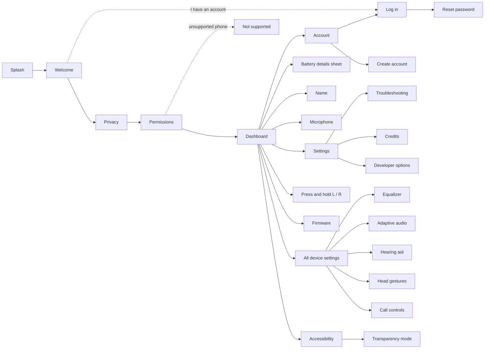

## Accessibility

- Every interactive element is at least 48 dp and has a TalkBack name. Each battery cell merges into one node, for example “Right bud, 48 percent, charging”.
- Listening modes are a radio group with Selected state. The check mark gives a selection cue that doesn’t depend on colour.
- Layout adapts to font scale: one row → 2 × 2 → single column for modes, cells → rows for battery, values move under titles. See the [200% export](screens/23-large-text-200.png).
- Text colours meet WCAG AA (4.5:1) against the surfaces they sit on. The lowest pair is the hint colour (`--on3`) on a surface container, at 4.7:1 in Glacier light. Light hint colours were darkened to reach this.
- Errors and refresh status use polite live regions.

## Google Play readiness

**UI** items are part of this redesign. **Code** items are outside the UI but block or risk publication. **Store** items are Play Console work.

| | Item | Status in this proposal |
| --- | --- | --- |
| UI | In-app privacy summary that matches the Data safety form, including the optional account | Designed (Privacy, Settings) |
| UI | In-app account deletion, plus a web deletion link for the listing | Designed (Account · signed in); the web page is still needed |
| UI | Request permissions in context with a reason; nothing chained | Designed (Permissions) |
| UI | Hide compatibility bypass, account service form, demo mode and Xposed options from Play users | Designed (Developer options) |
| UI | Remove LibrePods purchase banner, “Unlock advanced features”, “Connected to Linux” and other leftover strings | Listed above |
| UI | Edge-to-edge, predictive back and font scale up to 200% | Designed. The two-pane large-screen layout is specified but not drawn. |
| UI | Trademark notice: “AnDPoP is not affiliated with Apple Inc.” | Designed (Settings footer, listing) |
| Code | Add a `play` product flavor with `PLAY_BUILD = true`. Only `foss` exists today, so every Play-specific condition in the code is currently dead. | To do |
| Code | Protected permissions in the manifest (`BLUETOOTH_PRIVILEGED`, `MODIFY_PHONE_STATE`, `LOCAL_MAC_ADDRESS`, `INTERACT_ACROSS_USERS`) and Xposed hooks. Expect review questions. Strip them from the Play flavor if they are not needed there. | To decide |
| Code | Foreground service type `connectedDevice` needs the Play Console declaration and a short video | To do |
| Code | Move hard-coded English strings (permissions, privacy, account, head tracking, troubleshooting) to resources | To do |
| Code | Rename the notification channel that shows `BluetoothConnectionManager.aacpSocket?` | To do |
| Store | Icon 512 px, feature graphic 1024 × 500, 4–8 phone screenshots | Drafted on the [store board](screens/26-play-store-assets.png); final exports come from the native build |
| Store | Title without third-party marks: “AnDPoP”. Describe AirPods compatibility in the descriptions. | Drafted |
| Store | Hosted privacy policy URL and account deletion URL | Needed from you |
| Store | Data safety: email collected for account management, optional, not shared, encrypted in transit, deletable | Drafted |

## Existing tests the port must keep passing

`AppearanceRegressionTest` and `DashboardRegressionTest` rely on these:
- the texts “Adaptive”, “Transparency”, “Guava”, “Log in”, “Forgot password?”, “Send reset link”, “Create an account”, “Continue as guest”, “Battery details” and “Right bud”;
- the content descriptions “Settings”, “Charging” and “Close battery view”;
- the credits dialog containing “Based on LibrePods” with an OK button;
- a `ProgressBarRangeInfo` on each live gauge;
- “Transparency” on one line at 288 dp and 1.6× font scale;
- Settings showing “Appearance” after the dashboard’s Settings button.

The prototype keeps all of them. Two need care:
- The account entry changes from a text button to an avatar. Keep its content description “Account”.
- Account becomes a nav destination (decision 1). Its test can keep calling `AccountScreen(state, model, null)` directly.

## Port plan (after approval)

1. **Foundation:** tokens in `AndpopPalette.kt`, bundled Roboto Flex, the shared components and the motion spec. Delete the Apple branch.
2. **Dashboard and battery:** hero card, listening control, groups, tiles, sheet, empty and loading states. Run the existing instrumented tests.
3. **Detail screens:** All device settings and every sub-screen on the shared templates.
4. **Settings, troubleshooting, developer options.**
5. **First run and account:** splash, onboarding, account as a destination.
6. **System surfaces:** popup, island, notification, QS tile, widgets.
7. **Play flavor and store:** `play` flavor, manifest review, strings, final store graphics from the build.

Each step builds with `./gradlew :app:assembleFossDebug` and runs `connectedFossDebugAndroidTest` before the next one starts.

## Open questions

1. Do you approve decisions 1–9, or should any keep the current behaviour?
2. What are the URLs for the hosted privacy policy and the account deletion page?
3. Should the Play build keep Xposed features, or should they stay FOSS-only?
4. Do you want the new icon, or only a refresh of the current one?

---

Product photos: AirPods Pro 2 by Hajoon0102 (CC BY-SA 4.0) and AirPods Max by Arne Müseler (CC BY-SA 3.0 DE), as credited in the main README. AirPods is a trademark of Apple Inc.
